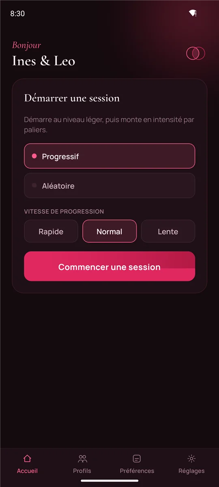
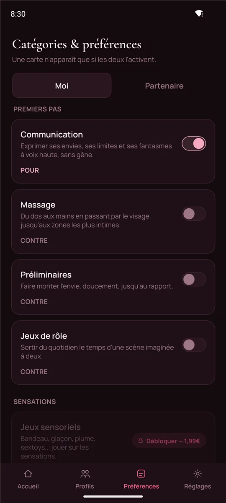
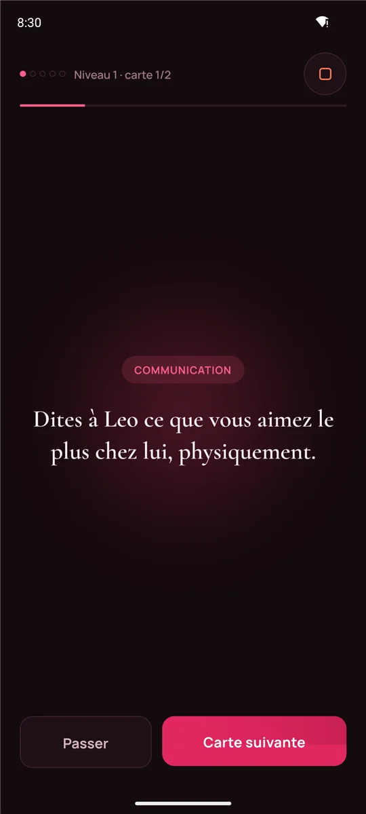
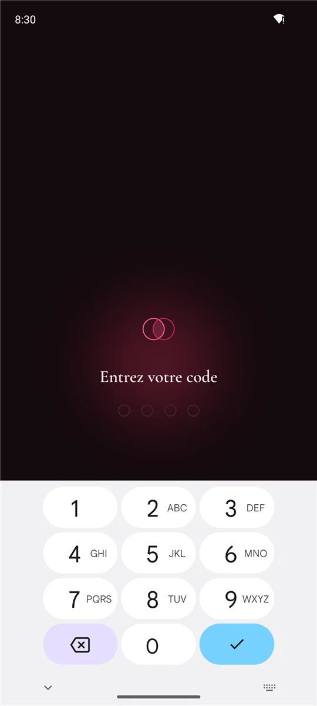

<p align="center">
  
</p>

<h1 align="center">Ensemble</h1>

<p align="center"><strong>Le jeu de cartes qui vous rapproche, une carte après l'autre.</strong><br>Pour les couples, sur Android.</p>

<p align="center">
  <a href="https://github.com/Forthtilliath/ensemble-releases/releases"><strong>Télécharger l'application</strong></a>
  ·
  <a href="https://forthtilliath.github.io/ensemble-releases/">Découvrir Ensemble</a>
</p>

> **Réservé aux adultes.** Ensemble contient du contenu sexuel explicite, destiné exclusivement aux couples majeurs et consentants.

Des questions, des gestes et des idées à partager à deux : de la simple conversation jusqu'aux moments les plus intimes, en montant en intensité à votre rythme. Et seulement ce que vous avez **tous les deux** accepté.

<p align="center">
  
  
  
  
</p>

## Comment ça marche

1. **Chacun choisit, en secret.** Treize catégories, de la communication aux jeux les plus audacieux. Chacun indique ce qui lui plaît, ou non. Une carte n'apparaît que si les deux ont dit oui : pas besoin de se justifier.
2. **On monte en intensité.** La session commence en douceur, puis monte par paliers jusqu'au cinquième niveau. Rapide, normal ou lent : c'est vous qui donnez le tempo. Ou bien laissez faire le hasard.
3. **Et on prend soin de l'autre.** Les cartes s'adressent à chacun son tour. Et pour finir, un « moment d'après » : câlins, débrief, petites attentions pour le lendemain.

## Plus de 700 cartes

Treize catégories, cinq niveaux d'intensité, et des cartes pensées pour chaque couple : femme-homme, femme-femme ou homme-homme.

| Pack | Catégories |
|---|---|
| **Premiers pas** (gratuit) | Communication, Massage, Préliminaires, Jeux de rôle |
| **Sensations** | Jeux sensoriels, Positions, Gourmandise |
| **Audace** | Anal, Domination & Soumission, Se montrer |
| **Après** | Aftercare, Débrief, Le lendemain |

Le pack Premiers pas est entièrement gratuit, sans publicité. Les autres packs seront proposés en achat unique, sans abonnement, dans une prochaine version.

## Votre intimité reste la vôtre

- **Rien ne quitte le téléphone** : ni compte, ni serveur, ni publicité, ni suivi. Vos profils et vos envies restent chez vous, chiffrés.
- **Code PIN** : quatre chiffres pour ouvrir l'app, qui se reverrouille dès que vous la quittez.
- **Mode discret** : sur l'écran d'accueil, Ensemble se fait passer pour « Notes », avec une icône neutre.
- **Pas de capture d'écran** : captures bloquées, et contenu masqué dans la liste des applications récentes.
- **Sauvegarde chiffrée** : changez de téléphone sans rien perdre, avec un fichier que seul votre mot de passe peut ouvrir.
- **Internet ne sert qu'aux mises à jour** : l'app demande à GitHub s'il existe une nouvelle version. Cette demande ne contient aucune de vos données.

## Installer Ensemble

1. Sur votre téléphone Android, ouvrez la [page des versions](https://github.com/Forthtilliath/ensemble-releases/releases) et téléchargez le fichier `Ensemble-<version>.apk` de la version la plus récente.
2. Ouvrez-le. Android vous demande, une seule fois, d'autoriser l'installation depuis votre navigateur : acceptez.
3. C'est installé.

Les versions suivantes arrivent directement dans l'app : un bandeau vous les annonce au lancement, et rien n'est installé sans votre accord. L'app vérifie que chaque fichier téléchargé correspond exactement à celui publié ici, et Android refuse toute mise à jour qui ne serait pas signée par la même clé. Vos données sont conservées d'une version à l'autre.

<details>
<summary>Vérifier l'authenticité de l'APK (utilisateurs avancés)</summary>

Toutes les versions d'Ensemble sont signées avec le même certificat, dont l'empreinte SHA-256 est :

```
2c3fdd976d3f4c6ad61eda0ad4ab784dbefc80fcc7a8f013629921c957afe4e3
```

Pour la comparer : `apksigner verify --print-certs Ensemble-<version>.apk`. L'empreinte SHA-256 de chaque fichier APK est aussi affichée sur la page de sa version.

</details>

## Questions fréquentes

**Est-ce gratuit ?**
Oui pour commencer : le pack Premiers pas est entièrement gratuit, sans publicité. Les autres packs seront vendus à l'unité, sans abonnement.

**Pourquoi l'app n'est-elle pas sur le Play Store ?**
Ensemble est distribuée directement, ici. C'est pour cela qu'Android demande d'autoriser l'installation la première fois.

**Et sur iPhone ?**
Ensemble est disponible sur Android uniquement.

**Que veut dire « version de test » ?**
L'app est encore en phase alpha : le contenu des cartes est en relecture, l'interface peut évoluer. Vos données sont conservées d'une version à l'autre.

**J'ai oublié mon code PIN.**
Il n'y a pas de récupération possible : c'est ce qui garantit qu'il protège vraiment l'app. Seul l'effacement des données de l'app (Réglages Android ▸ Applications ▸ Ensemble ▸ Stockage ▸ Effacer les données) permet de repartir de zéro.

**Je ne trouve plus l'app sur mon écran d'accueil.**
Le mode discret est peut-être activé : cherchez « Notes ».
